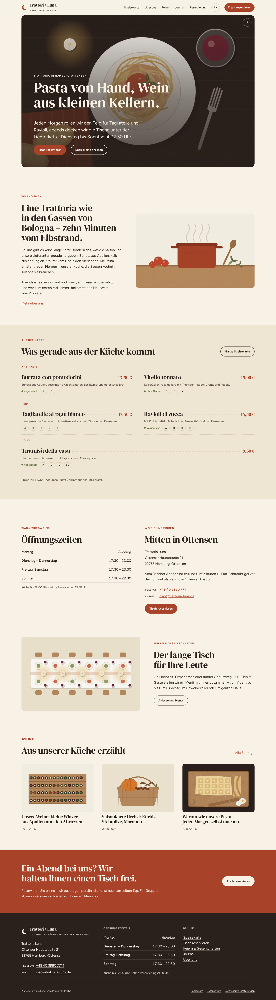
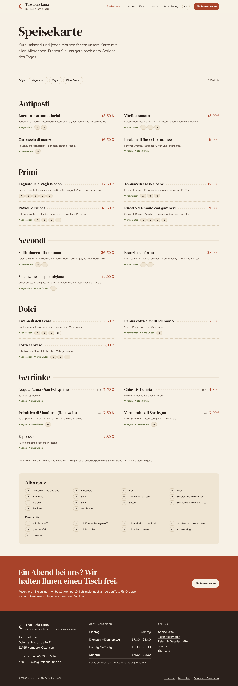
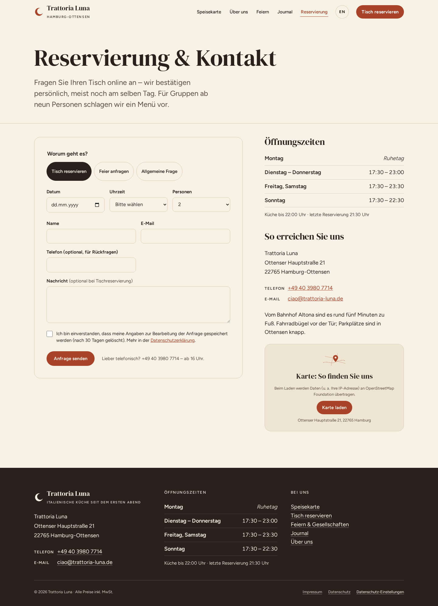
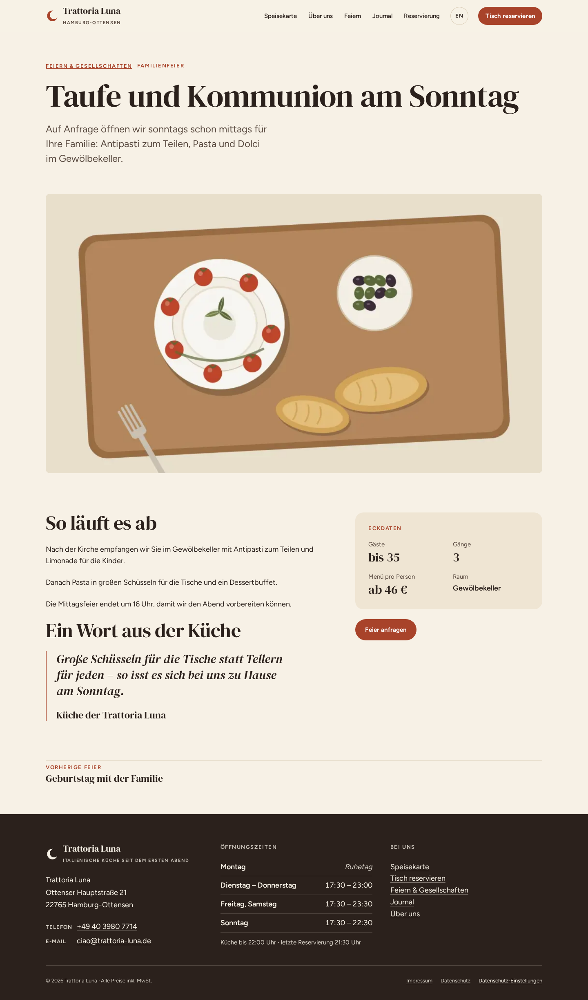
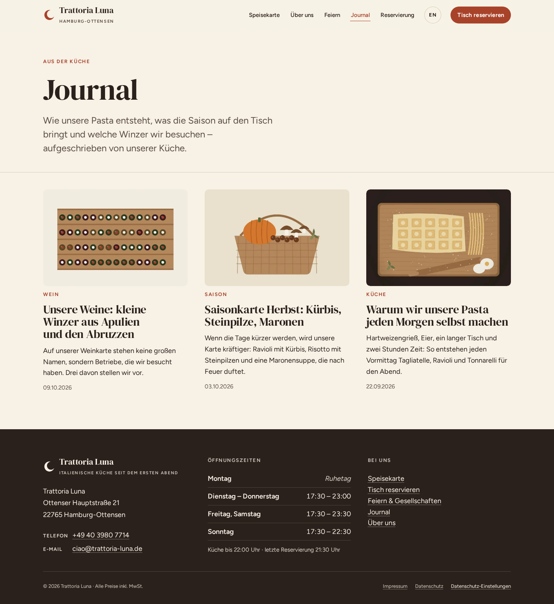
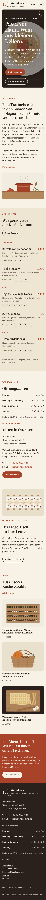
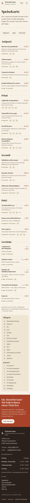
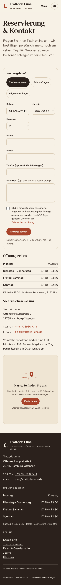

# Showcase: Trattoria Luna — WordPress-Webseite aus einem Satz

```
/onecommand:onecommand "WordPress Webseite für unser Restaurant Trattoria Luna in Hamburg"
```

OneCommand erkannte den Blueprint `website` mit dem Branchenkontext `restaurant` und die Plattform WordPress.
Daraus baute es ein Block-Theme, ein Site-Plugin und Demo-Inhalte. Das Design kommt aus dem Design-Brief
(`oc-frontend-design`), Bewegung und Feinschliff aus `/emil`. Seiten wurden nicht nachbearbeitet.

| | |
|---|---|
| Plattform | WordPress 6.8, Block-Theme (Full Site Editing) mit 29 Patterns, eigenes Site-Plugin, keine Fremd-Plugins |
| Umfang | 23 Module, 13 Seiten (Deutsch und Englisch), Speisekarte mit 14 Allergenen und Zusatzstoffen, Tischanfrage, Feiern, Journal |
| Abnahme | 31 von 31 automatischen Akzeptanzkriterien grün (21 Playwright-Dateien), 3 manuelle; WordPress-Gate `--stage all` grün |
| Datenschutz | keine Anfrage an Drittanbieter, Karte und Video erst nach Klick, kein Cookie-Banner nötig |
| Sicherheit | Benutzerliste und Autoren-Archiv gesperrt, XML-RPC aus, Nonces und Escaping vom Gate geprüft |

Der Build lief mit OneCommand 1.14.0. Er zeigte Lücken im Plugin: Der Rundgang fotografierte die Seite mit
Admin-Leiste, Lazy-Bilder blieben leer, Datumsfelder zeigten `mm/dd/yyyy`, und ein toter Link fiel nicht auf.
Behoben wurde das im Plugin (Version 1.15.0), nicht auf der Seite. Die Bilder stammen aus dem UI-Rundgang des
1.15.0-Gates auf demselben Build: als Besucher, ohne Admin-Leiste, mit Linkprüfung.

Adresse, Inhaber, Telefonnummer, Speisekarte und Preise sind Demo-Daten. Der Build hat sie als „zu prüfen“
markiert. Ab 1.15.0 stehen solche Angaben in `demo_facts` und im Lieferbericht unter „Vor dem Livegang
ersetzen“. Die Illustrationen hat der Build selbst gezeichnet — statt Stockfotos von Gerichten, die nicht auf
der Karte stehen, bis eigene Fotos da sind.

## Desktop

### Startseite


### Speisekarte mit Allergenen und Filtern


### Reservierung und Kontakt


### Feier-Detail


### Journal


## Mobil

| Startseite | Speisekarte | Reservierung |
|---|---|---|
|  |  |  |
